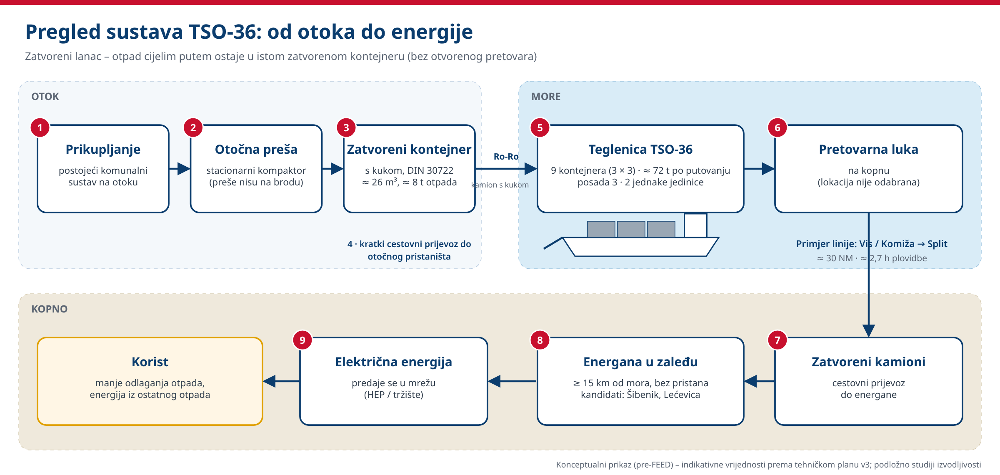
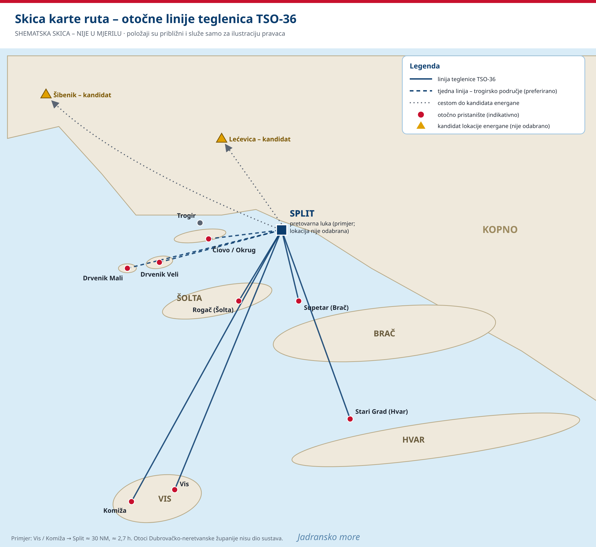
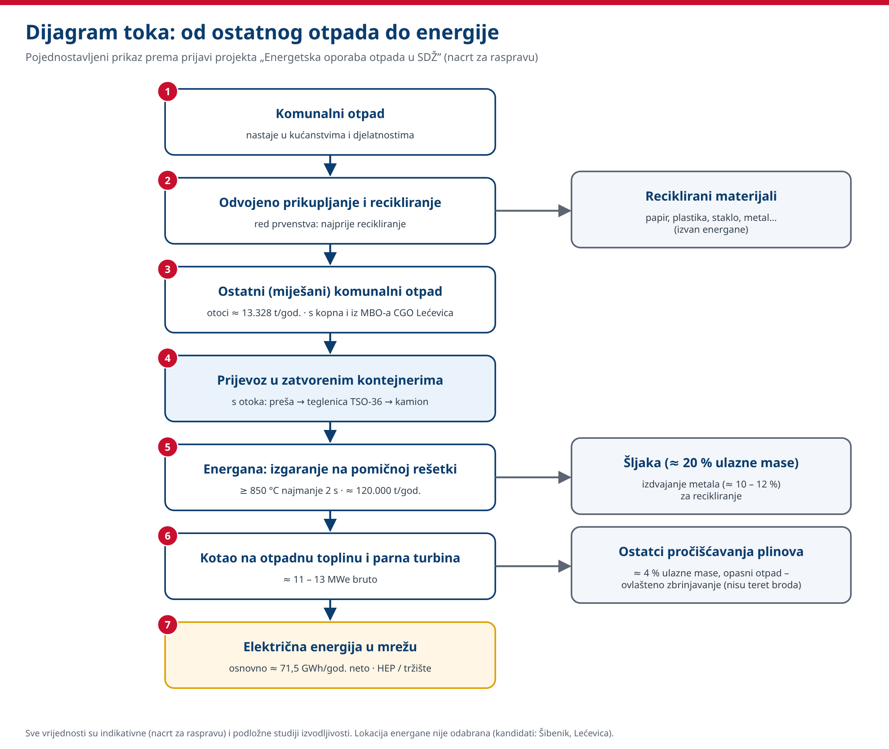

# Teglenica TSO-36

**Javna dokumentacija** koncepta otočne teglenice za prijevoz otpada **TSO-36**. Riječ je o pomorskoj logistici u zatvorenim kontejnerima s dalmatinskih otoka do pretovarne luke na kopnu, uz mogućnost energetske oporabe ostatnog komunalnog otpada u Splitsko-dalmatinskoj županiji (SDŽ), Hrvatska.

**Autor i voditelj projekta:** Maciej Grajczyk (autor i voditelj projekta · voditelj razvoja)  
**Licencija:** [MIT](LICENSE)  
**Repozitorij:** [galion-studio/Teglenica-TSO-36](https://github.com/galion-studio/Teglenica-TSO-36)

> **Status:** koncept / pre-FEED. Ovo **nije** projekt broda odobren od klasifikacijskog društva. Lokacija postrojenja **nije odabrana**, a dokumentacija **ne predstavlja** građevinsku ni okolišnu dozvolu. Financiranje ovisi o pravilima o državnim potporama i odobrenju kreditora.

---

## Ukratko za javnost

**Što brod radi?** Na otoku se ostatni otpad preša u zatvorene kontejnere. Teglenica TSO-36 preuzima te kontejnere u otočnom pristaništu i prevozi ih morem do pretovarne luke na kopnu, a odande zatvoreni kamioni voze otpad do postrojenja u zaleđu. Otpad cijelim putem ostaje u istom zatvorenom kontejneru, bez otvorenog pretovara, mirisa i procjednih voda u moru.

**Zašto je to važno za otoke?** Otoci dobivaju redovit i pouzdan odvoz otpada i ljeti, kada se količine otprilike udvostručuju. Dvije jednake teglenice omogućuju da jedna bude na održavanju dok druga i dalje vozi.

**Što je energetska oporaba otpada?** Ostatni otpad je ono što ostane nakon odvojenog prikupljanja i recikliranja. Umjesto odlaganja na odlagalište, u energani izgara pod nadzorom (na pomičnoj rešetki), a dobivena toplina pretvara se u električnu energiju koja se predaje u mrežu. Tako se smanjuje odlaganje otpada i pridonosi cilju Republike Hrvatske da se do 2035. odlaže najviše 10 % komunalnog otpada. Recikliranje ostaje na prvom mjestu.

*Slika 1. Pregled sustava: otočna preša → zatvoreni kontejner → teglenica TSO-36 → pretovarna luka → zatvoreni kamioni → energana → električna energija (konceptualni prikaz).*

---

## Što je TSO-36

| Stavka | Opis (koncept) |
|---|---|
| Plovilo | Kompaktna samohodna teglenica za **9 zatvorenih kontejnera** po putovanju (DIN 30722) |
| Rukovanje teretom | Jednostavna rampa i jednostavno rukovanje kontejnerima (industrijski, dalmatinski izgled – bez ukrasa) |
| Posada | 3 (zapovjednik + 2) |
| Plan flote | **Dvije** jednake jedinice TSO-36 (jedan natječaj, serijska gradnja) |
| Otočni lanac | Brač, Hvar, Šolta, Vis (+ Čiovo/Okrug – Trogir te Drvenik Veli/Mali, preferirano tjedno) |
| Preše (kompaktori) | Preše na otocima → zatvoreni kontejneri DIN 30722 (na plovilu nema preše) |
| Kandidati za postrojenje | **Šibenik** i **Lećevica** (nijedan nije odabran) |

Obrađeni primjer linije: **Vis / Komiža → Split** (pretovarna luka), zatim zatvorenim kamionima do postrojenja u zaleđu.

*Slika 2. Shematska skica ruta – nije u mjerilu. Prikazani su Split, Trogir/Čiovo, Drvenik Veli i Mali, Šolta (Rogač), Brač (Supetar), Hvar (Stari Grad) i Vis/Komiža. Položaji pristaništa i pretovarne luke su indikativni.*

*Slika 3. Pojednostavljeni dijagram toka otpad-u-energiju prema prijavi projekta. Sve su vrijednosti indikativne.*

---

## Dokumenti (`docs/`)

| Datoteka | Opis |
|---|---|
| [docs/Tehnicki_plan_teglenica_SDZ_v3.pdf](docs/Tehnicki_plan_teglenica_SDZ_v3.pdf) | **Važeći** tehnički plan (v3, 41 str.): 2 × TSO-36, kandidati za postrojenje Šibenik i Lećevica, otočne preše i kopnena logistika |
| [docs/Tehnicki_plan_teglenica_SDZ_v2.pdf](docs/Tehnicki_plan_teglenica_SDZ_v2.pdf) | Prethodni tehnički plan (v2, zadržan radi usporedbe) |
| [docs/Prijava_projekta_EOO_SDZ.pdf](docs/Prijava_projekta_EOO_SDZ.pdf) | Prijava projekta energetske oporabe otpada (SDŽ) |
| [docs/Konceptualni_prikazi_oznaceno.pdf](docs/Konceptualni_prikazi_oznaceno.pdf) | Označeni konceptualni prikazi (teglenica i logistički lanac) |
| [docs/images/](docs/images/) | Dijagrami za ovaj README (PNG i izvorni SVG) |

Čitanje počnite s **v3**. Brojke i pretpostavke u PDF dokumentima imaju prednost pred ovim README-om ako se razlikuju.

---

## Načela projekta (javno)

- Zahvala općine ili grada **nije** potpora projektu.
- Materijali za neplaćeno (organsko) informiranje javnosti izrađeni na temelju ovog repozitorija ne smiju se predstavljati kao plaćena promocija.
- Uloga autora do osnivanja projektnog društva (SPV): **autor i voditelj projekta / voditelj razvoja**, a ne *nositelj* ni *glavni inženjer*.

---

## Što ovaj repozitorij *nije*

- Nije odabrana lokacija postrojenja
- Nisu dozvole ni FEED dokumentacija
- Nije osnovano projektno društvo (SPV)
- Nije Galion One / Galion Voice (zasebni proizvodi Galion Studija)
- Podatkovni centar nije dio ovog projekta

---

## Kontakt

Maciej Grajczyk – autor i voditelj razvoja projekta.
E-adresa i broj telefona radi zaštite privatnosti nisu objavljeni u ovom README-u.

---

## Licencija

Dokumentacija i dijagrami u ovom repozitoriju objavljeni su pod licencijom [MIT](LICENSE).

---

*Dokumentacija se može mijenjati. Verzija tehničkog plana u ovom repozitoriju: **v3**.*
